# ShopNow DevOps Capstone: final delivery

**End-to-end CI/CD for the ShopNow MERN shop on AWS EKS, run live on 12–13 November 2026.**

Team: Susmitha (Terraform / AWS) · Kaushik (Jenkins) · Avinash (Docker / Kubernetes) · Ravi (Ansible / monitoring)

This folder is the proof that the whole project works. It walks through one
complete live session, step by step, from an empty AWS account to a monitored,
autoscaling shop, and back to nothing. Every step has the command that was run
and a screenshot of the real result.

| In this folder | What it is |
|---|---|
| `README.md` | This document: the live run, step by step |
| `screenshots/` | 46 screenshots from the run, numbered in the order they were taken |
| `ShopNow_DevOps_Capstone.pptx` | The presentation |

Repository: <https://github.com/banalasusmitha/Capstone_Project-Web-Application-with-CI-CD-DevOps> ·
App source: <https://github.com/banalasusmitha/shopNow>

---

## Project goals and where the proof is

| # | Goal | Proved in | Screenshots |
|---|---|---|---|
| 1 | Architecture with load balancing, container orchestration and monitoring | Steps 8–11 | [20](screenshots/20-smoke-tests.png), [30](screenshots/30-grafana-shopnow-dashboard.png), [36](screenshots/36-hpa-scale-up.png) |
| 2 | AWS infrastructure with Terraform: VPC, subnets, EKS | Steps 1, 5, 6, 13 | [11](screenshots/11-infra-plan-summary.png), [14](screenshots/14-infra-approval.png), [15](screenshots/15-infra-apply-complete.png), [44](screenshots/44-infra-destroy-complete.png) |
| 3 | Configuration management with Ansible | Step 7 | [17](screenshots/17-ansible-run1-recap.png), [18](screenshots/18-ansible-idempotent.png) |
| 4 | Deploy on EKS with scalability and resilience | Steps 8, 11, 12 | [19](screenshots/19-app-pipeline-stage-view.png), [36](screenshots/36-hpa-scale-up.png), [40](screenshots/40-mongodb-data-persisted.png) |
| 5 | Jenkins CI/CD from code to production | Steps 2–8 | [06](screenshots/06-jenkins-jobs.png), [10](screenshots/10-jenkins-iam-role.png), [19](screenshots/19-app-pipeline-stage-view.png), [20](screenshots/20-smoke-tests.png) |
| 6 | Monitoring with Prometheus and Grafana | Step 10 | [30](screenshots/30-grafana-shopnow-dashboard.png), [33](screenshots/33-prometheus-jenkins-target-up.png), [35](screenshots/35-prometheus-shopnow-alert-rules.png), [41](screenshots/41-grafana-hpa-scaling.png) |
| — | Cost optimisation | Step 13 and [Cost](#cost) | [44](screenshots/44-infra-destroy-complete.png), [46](screenshots/46-zero-check.png) |

---

## The flow at a glance

```
 Laptop ── terraform apply ──► Jenkins server (EC2, IAM role, no access keys)
                                   │
                    Job 1 · 1-infra-terraform: plan → human approval → apply
                                   │   VPC, NAT, EKS 1.36, ECR, IAM, CI agent (61 resources)
                                   ▼
                    Job 2 · 2-config-ansible: playbook on the CI agent, run twice
                                   │
                                   ▼
                    Job 3 · 3-app-cicd: checks → build 3 images → container tests
                                   │   → push to ECR → deploy to EKS → smoke tests
                                   ▼
 Browser ──► AWS load balancer ──► ingress-nginx ──► /avinash · /avinash-admin · /avinash/api
                                                         storefront · admin · API ──► MongoDB (gp3 disk)

 Prometheus + Grafana watch the cluster and the Jenkins server · HPA scales the backend 2–4 pods
```

---

## Before you start

| Need | Check |
|---|---|
| Laptop tools: Terraform ≥ 1.10, AWS CLI v2, kubectl 1.36, Helm 3, Git (WSL on Windows) | `terraform -version`, `aws --version` |
| Credentials for the shared account `095355901688`, region `ap-south-1` | `aws sts get-caller-identity` |
| Your public IP in `admin_cidrs` of `terraform-Sushmita/jenkins/terraform.tfvars` and `envs/dev/terraform.tfvars` | `curl ifconfig.me` |
| The private key `~/.ssh/shopnow-ci-agent` (shared privately, never in Git) | `ls -l ~/.ssh/shopnow-ci-agent` |
| The S3 state bucket from `terraform-Sushmita/bootstrap/` (created once) | `aws s3 ls \| grep shopnow-tfstate` |

```bash
cd ~/Capstone_Project-Web-Application-with-CI-CD-DevOps
git checkout main && git pull
export AWS_PROFILE=shared
```

---

## Step 1 · Build the Jenkins server with Terraform (laptop, ~3 min)

The Jenkins server is its own Terraform stack, so destroying the cluster from
Jenkins can never delete Jenkins itself.

```bash
cd terraform-Sushmita/jenkins
terraform init -backend-config=backend.hcl
terraform plan -out=tfplan
terraform apply tfplan
```

**Result:** 7 resources added: EC2 (`t3.medium`, Amazon Linux 2023), Elastic IP,
security group, key pair, IAM role and instance profile. Jenkins is at
`http://<public_ip>:8080`.

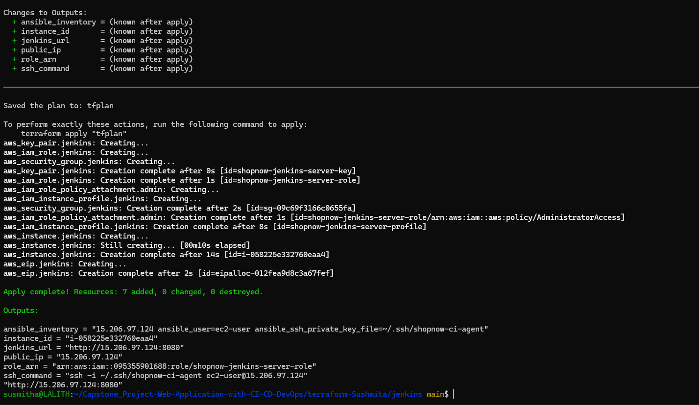

---

## Step 2 · Install Jenkins (on the server, ~5 min)

```bash
ssh -i ~/.ssh/shopnow-ci-agent ec2-user@<jenkins public ip>

# on the server
git clone -b kaushik-live-validation https://github.com/banalasusmitha/Capstone_Project-Web-Application-with-CI-CD-DevOps.git capstone
cd capstone
sudo bash jenkins-Kaushik/server/install-jenkins.sh --branch kaushik-live-validation
sudo cat /var/lib/jenkins/casc/admin-password      # admin login, never shared
```

Kaushik's branch `kaushik-live-validation` has his latest installer updates; once it is merged, use `main` in both places.

The installer sets up Jenkins LTS, Java 21, Docker, Terraform, kubectl,
Helm, Ansible, the AWS CLI and the plugins, then loads Configuration as Code,
which creates the admin user and the three jobs. There is no setup wizard.

| Login to the server | The installer's summary |
|---|---|
| 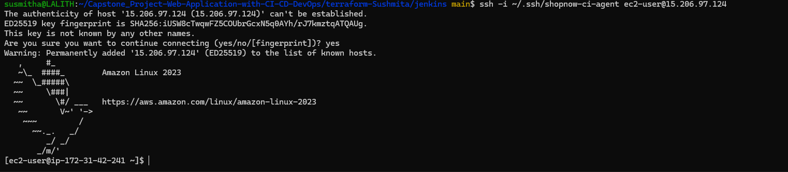 | 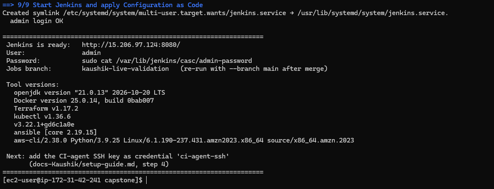 |

<details><summary>Supporting: the project cloned on the server</summary>

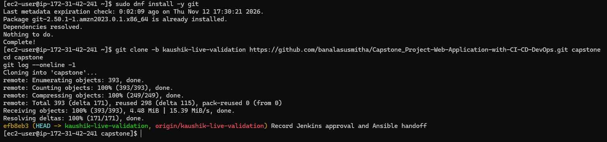
</details>

---

## Step 3 · Log in: the jobs and the plugins

Open `http://<jenkins public ip>:8080` and log in as `admin`. The folder
**ShopNow Capstone** and its three jobs already exist, created from code.

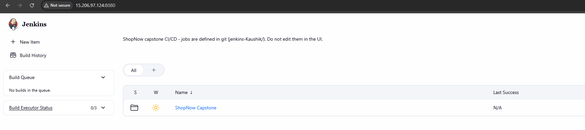

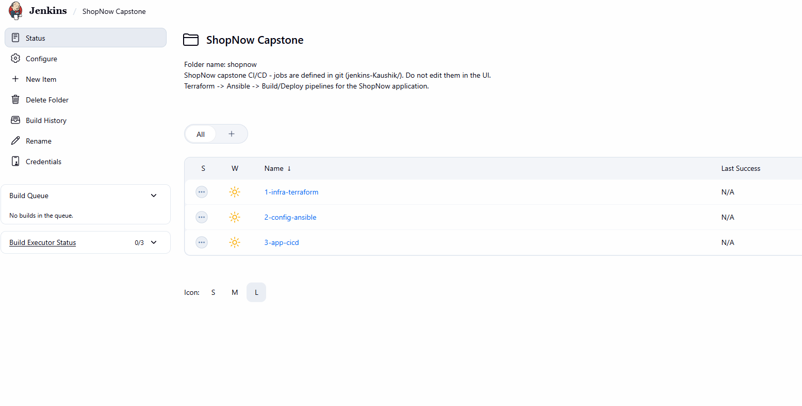

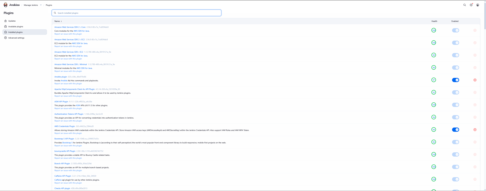

---

## Step 4 · Give Jenkins the CI-agent key

**Manage Jenkins → Credentials → System → Global → Add Credentials**:
kind *SSH Username with private key*, ID `ci-agent-ssh`, user `ec2-user`, and
the contents of `~/.ssh/shopnow-ci-agent`. This is the only secret Jenkins
holds, and it is never in Git.

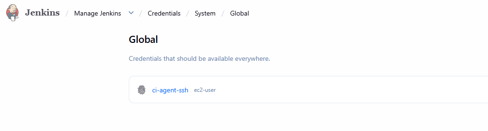

---

## Step 5 · Job 1: Terraform plan (safe, changes nothing)

**1-infra-terraform → Build Now.** The first run uses `ACTION = plan`.

The *Preflight* stage proves Jenkins reaches AWS through its **IAM role**, with
no access keys, and stops if the account is not the shared one:

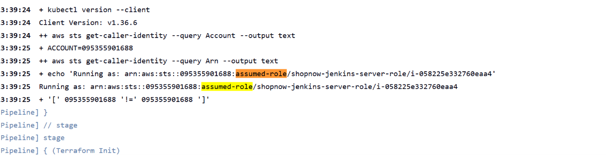

The plan: **61 to add, 0 to change, 0 to destroy.** With `plan`, the approval
and apply stages are skipped.

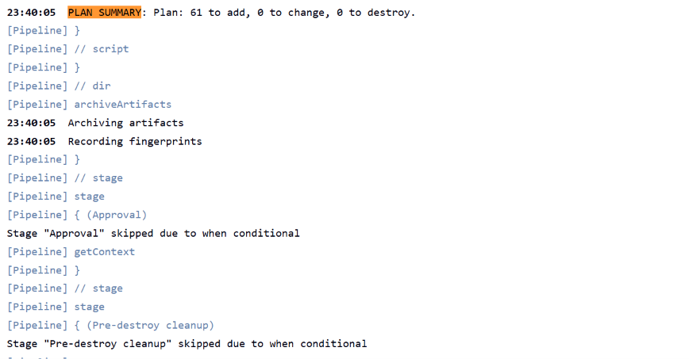

| Build #1 passed | Stage view |
|---|---|
| 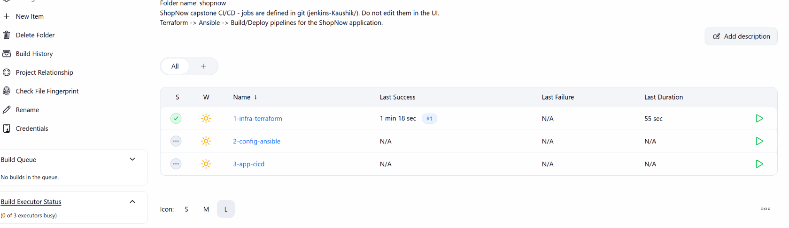 | 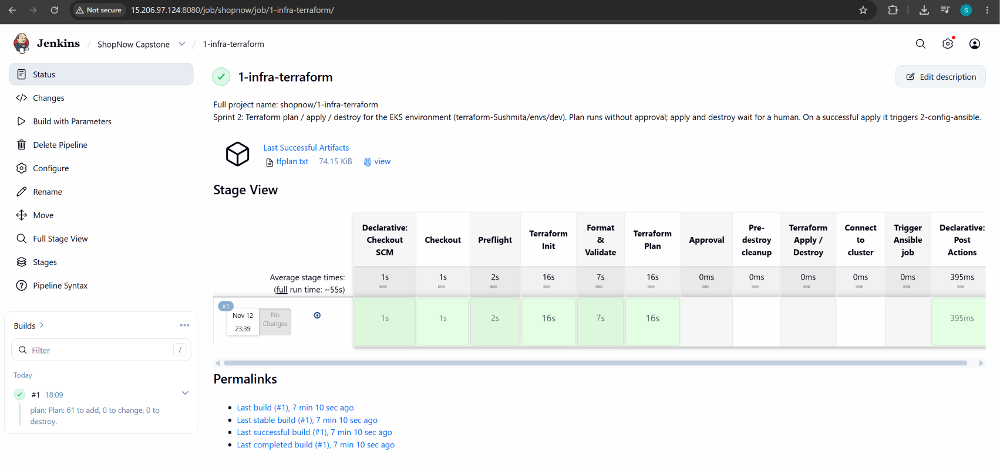 |

---

## Step 6 · Job 1: apply, with a human approval (~15 min)

**Build with Parameters:** `ACTION = apply`, `RUN_ANSIBLE_AFTER` ✔,
`DEPLOY_APP_AFTER` ✔. One click runs Terraform → Ansible → app.

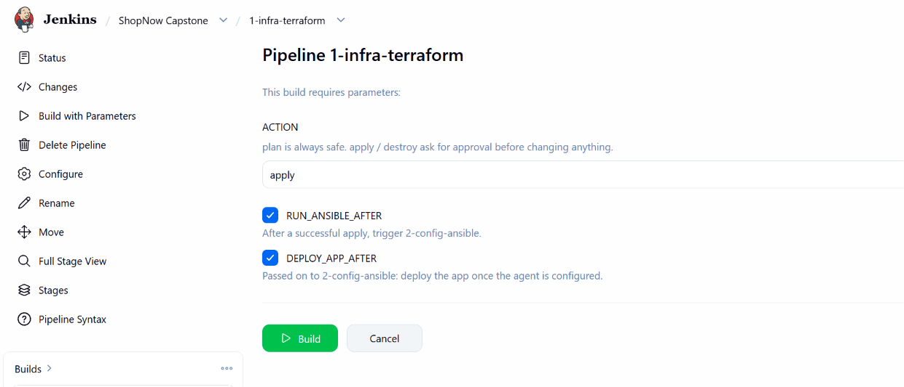

The job **stops and waits for a person** before changing anything:

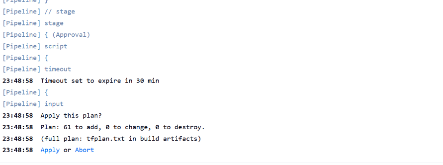

After **Apply**: VPC with public and private subnets in 2 zones, NAT gateway,
EKS 1.36 with 2 nodes and 5 add-ons, IAM roles, ECR repositories and the CI
agent. **61 added, 0 changed, 0 destroyed.** Jenkins then starts job 2.

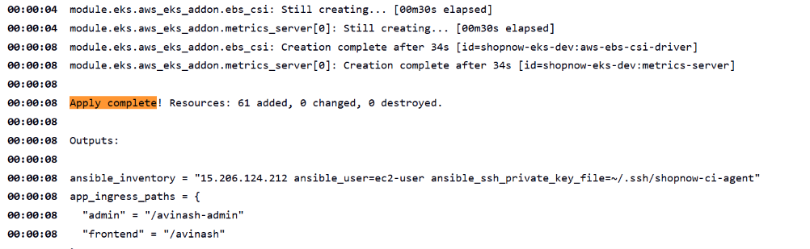

---

## Step 7 · Job 2: Ansible configures the CI agent

Ravi's `ansible-Ravi/site.yml` runs against the CI agent, found by its AWS tag
(`Role=ci_agent`), never a hard-coded IP. It installs Docker, Git, Java and
kubectl (checksum verified), then **runs a second time**. The second run must
change nothing.

| First run: `changed=4`, `failed=0` | Second run: `changed=0`, idempotent |
|---|---|
| 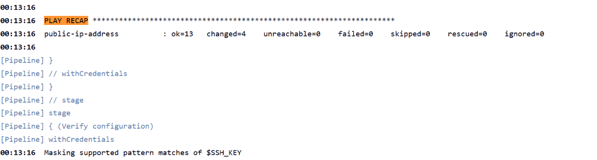 | 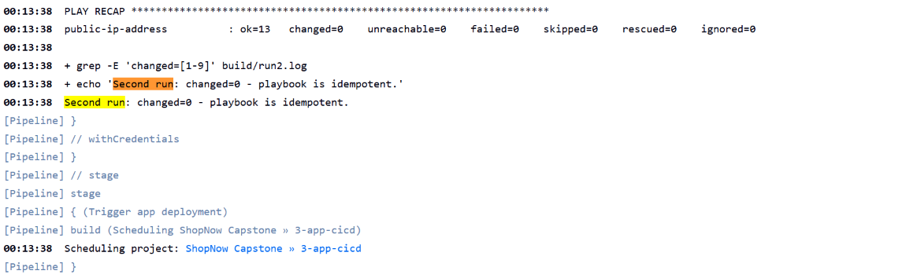 |

When it succeeds, it starts job 3 by itself:

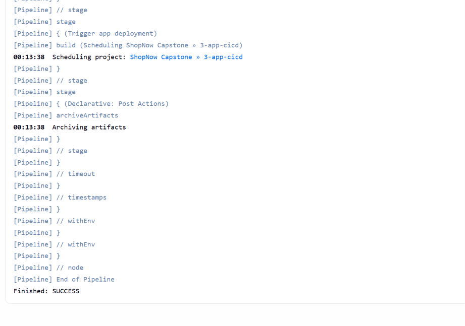

> **Tip:** Jenkins only learns a job's parameters after that job has run once.
> If job 2's very first automatic run stops in *Preflight* with an empty
> playbook name, start it once yourself with **Build with Parameters**
> (`DEPLOY_APP_AFTER` ✔). Every run after that works on its own.

---

## Step 8 · Job 3: build, test and deploy the app (~4 min)

Kaushik's root `Jenkinsfile` checks out the shopNow app and then:

1. Runs static checks (`npm audit`, hadolint, manifest check).
2. Builds 3 images (frontend and admin with `--build-arg USER_NAME=avinash`).
3. Runs the 3 containers together and tests them before anything is pushed.
4. Pushes to ECR, tagged with the build number.
5. Deploys Avinash's manifests to EKS (MongoDB StatefulSet, Deployments, Services, Ingress, HPA).
6. Runs smoke tests inside the cluster and through the load balancer.

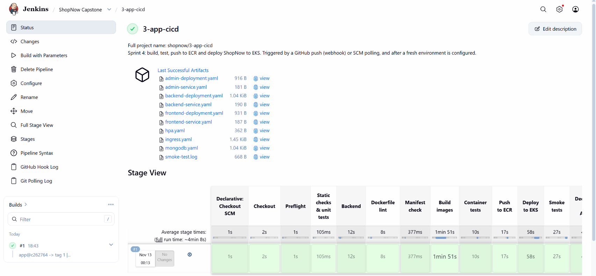

**All smoke tests passed**: API health, products from MongoDB, `/avinash/`,
`/avinash-admin/` and `/avinash/api/health` through the load balancer.

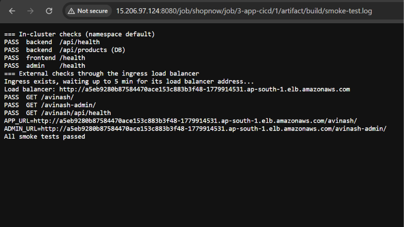

---

## Step 9 · Use the shop

Connect kubectl from the laptop:

```bash
aws eks update-kubeconfig --region ap-south-1 --name shopnow-eks-dev
kubectl get nodes
```

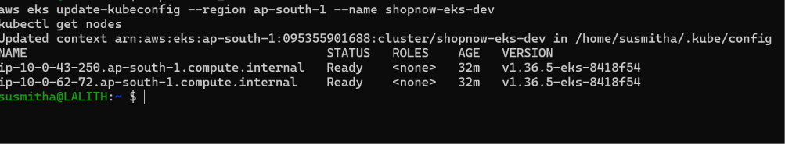

Route the admin panel's API calls (`/avinash-admin/api`) to the backend, the
same way `/avinash/api` is routed for the storefront:

```bash
cat <<'EOF' | kubectl apply -f -
apiVersion: networking.k8s.io/v1
kind: Ingress
metadata:
  name: shopnow-admin-api-ingress
  annotations:
    nginx.ingress.kubernetes.io/use-regex: "true"
    nginx.ingress.kubernetes.io/rewrite-target: /api/$2
spec:
  ingressClassName: nginx
  rules:
    - http:
        paths:
          - path: /avinash-admin/api(/|$)(.*)
            pathType: ImplementationSpecific
            backend:
              service:
                name: backend-service
                port:
                  number: 5000
EOF
```

**Storefront** at `http://<load balancer>/avinash/`:

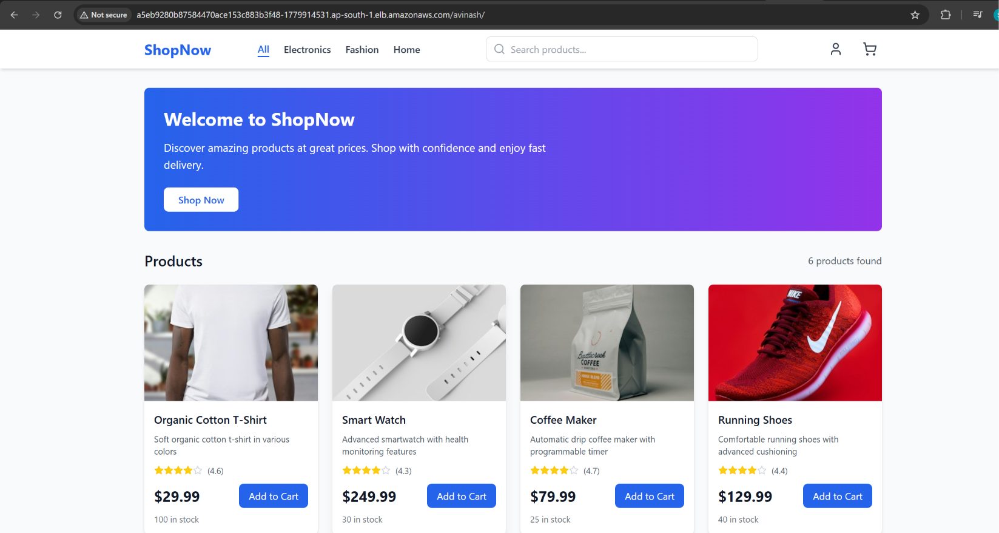

Checkout gives a pickup token and downloads the invoice:

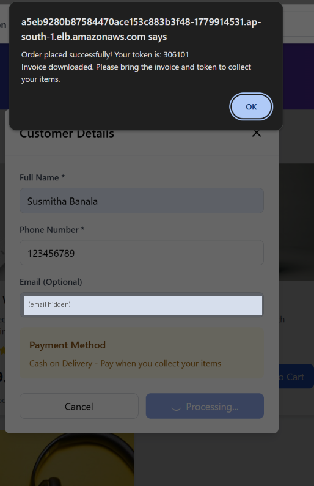

**Admin panel** at `http://<load balancer>/avinash-admin/`: the real orders
from MongoDB, then marked **Ready** for pickup:

| New orders | Marked Ready |
|---|---|
| 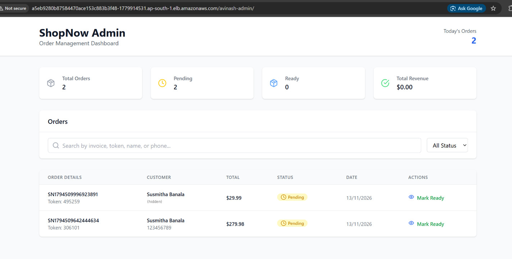 | 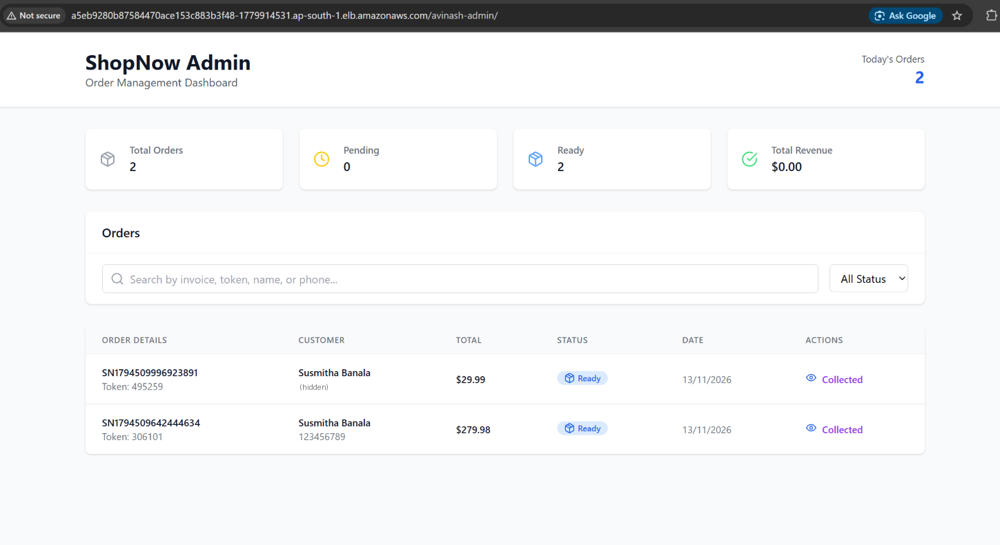 |

---

## Step 10 · Monitoring: Prometheus and Grafana (~10 min)

Ravi's `monitoring-Ravi/` installs `kube-prometheus-stack` with Helm. Grafana
and Prometheus stay private (ClusterIP) and are opened with `kubectl
port-forward`.

```bash
# point Ravi's Jenkins scrape job at this session's Jenkins (temporary copy, repo unchanged)
sed 's/REPLACE_WITH_JENKINS_HOST_OR_IP:8080/<jenkins public ip>:8080/' monitoring-Ravi/values.yaml > /tmp/values-live.yaml

kubectl create namespace monitoring
kubectl create secret generic grafana-admin-credentials -n monitoring \
  --from-literal=admin-user=admin --from-literal=admin-password='<choose a password>'

helm repo add prometheus-community https://prometheus-community.github.io/helm-charts
helm repo update
helm upgrade --install monitoring prometheus-community/kube-prometheus-stack \
  --version 92.14.1 --namespace monitoring --values /tmp/values-live.yaml --wait --timeout 15m
kubectl apply -f monitoring-Ravi/alert-rules.yaml
kubectl get pods -n monitoring
```

| Helm: deployed | 7 monitoring pods running, alert rules loaded |
|---|---|
| 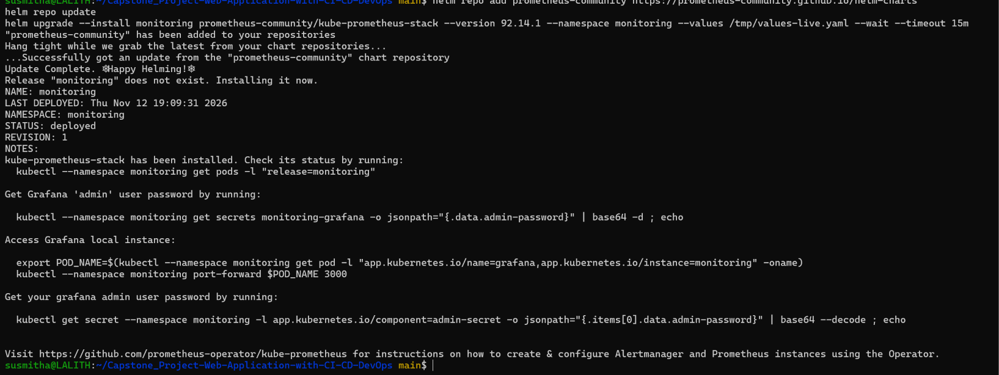 | 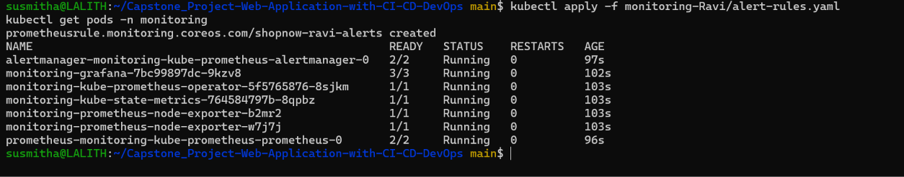 |

Load Ravi's **ShopNow Application Health** dashboard into Grafana through the
dashboard sidecar (a ConfigMap with the label `grafana_dashboard=1`):

```bash
awk '/json: \|-/{f=1;next} /^prometheusOperator:/{f=0} f' monitoring-Ravi/values.yaml > /tmp/shopnow-dashboard.json
kubectl create configmap shopnow-dashboard -n monitoring --from-file=shopnow-dashboard.json=/tmp/shopnow-dashboard.json
kubectl label configmap shopnow-dashboard -n monitoring grafana_dashboard=1
```

Open Grafana with `kubectl port-forward -n monitoring svc/monitoring-grafana 3000:80`
and go to <http://localhost:3000>:

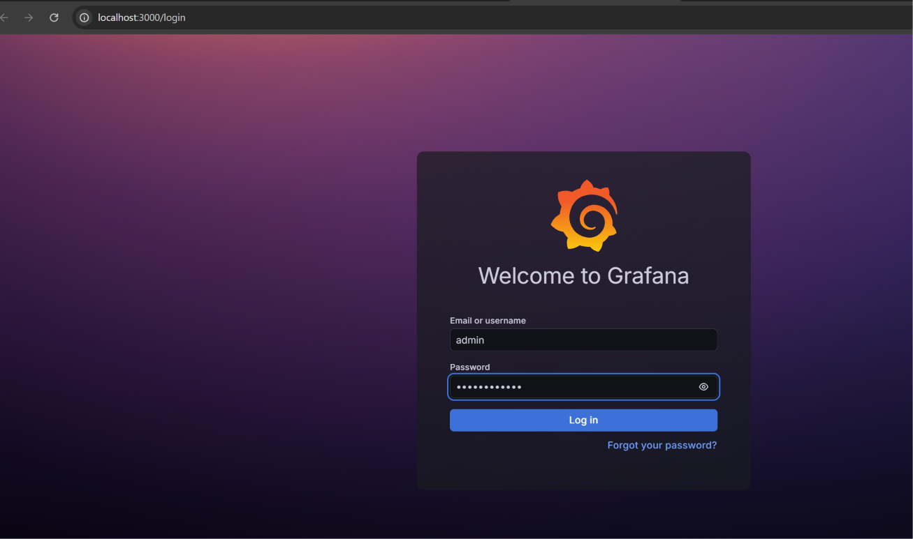

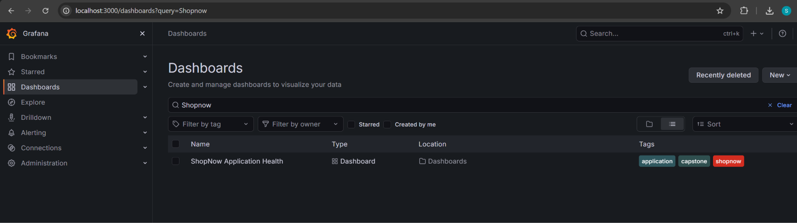

**ShopNow Application Health**: 6 available replicas, 0 restarts, CPU and memory per pod:

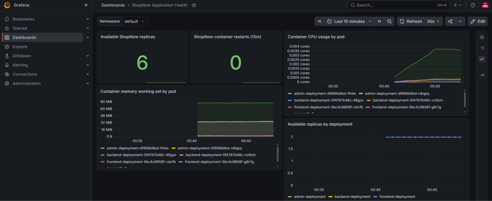

| Cluster compute resources | A worker node (Node Exporter) |
|---|---|
| 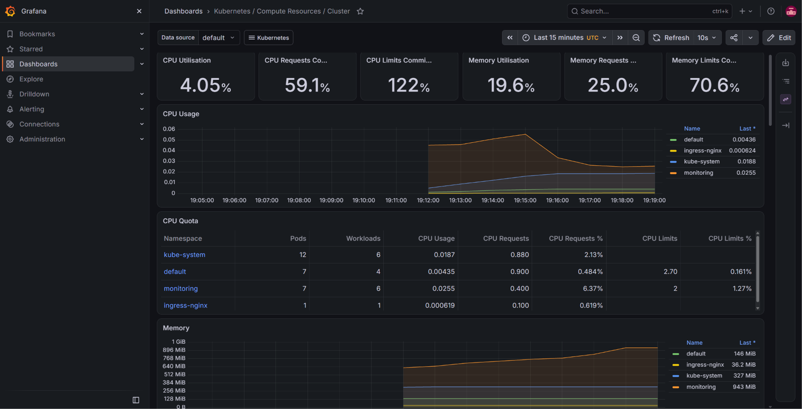 | 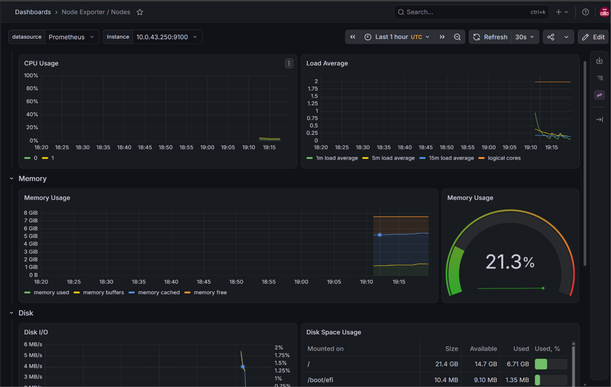 |

Prometheus (`kubectl port-forward -n monitoring svc/monitoring-kube-prometheus-prometheus 9090:9090`)
also scrapes the **Jenkins server** (job `jenkins`, `/prometheus`): **UP**. This
works because Terraform allows only the cluster's NAT IP to reach Jenkins on
8080.

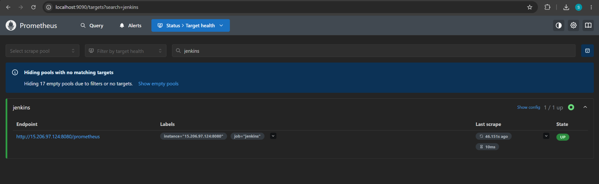

Ravi's alert rules (`shopnow.cluster.rules`): node not ready, pod crash-looping,
high CPU, replicas unavailable. *Inactive* means healthy.

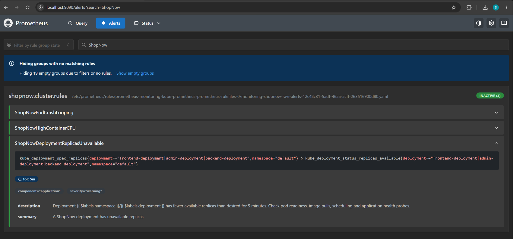

<details><summary>Supporting: the private port-forward</summary>

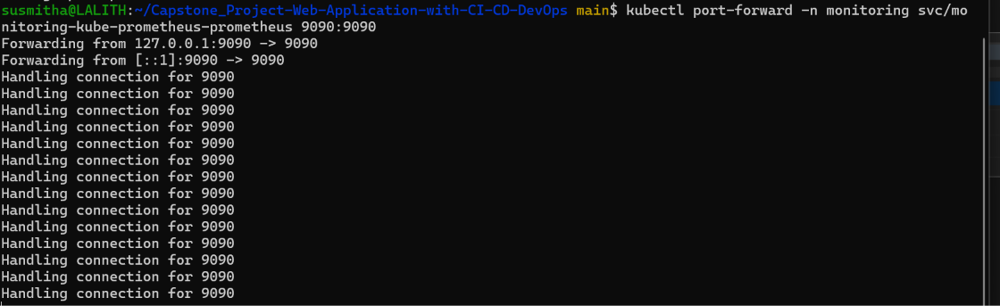
</details>

---

## Step 11 · Autoscaling under load (~3 min)

```bash
kubectl run load-test --image=busybox:1.36 --restart=Never -- /bin/sh -c \
  "for i in \$(seq 1 16); do (while true; do wget -q -O- http://backend-service:5000/api/products >/dev/null; done) & done; wait"
kubectl get hpa backend-hpa -w
```

Backend CPU climbs past the 70% target, and the **HPA scales the backend from
2 to 3 to 4 pods** (its maximum):

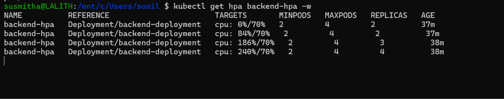

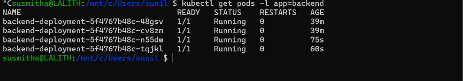

Grafana shows the same thing: replicas **6 → 8**, backend **2 → 4**, the CPU
spike and its return, and **0 restarts**:

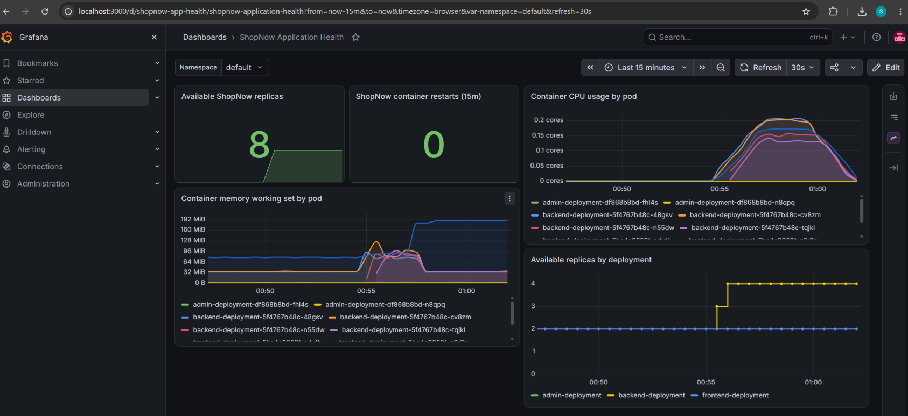

```bash
kubectl delete pod load-test     # the HPA scales back down by itself
```

---

## Step 12 · Self-healing and data that survives

Delete the database pod on purpose:

```bash
kubectl delete pod mongodb-0
kubectl get pods -w
```

Kubernetes recreates `mongodb-0` in seconds:

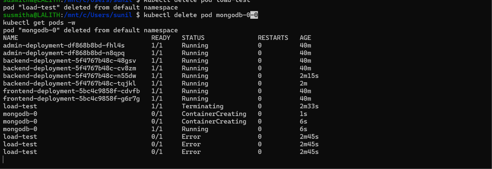

It is a new pod on the **same** 5 GiB gp3 volume:

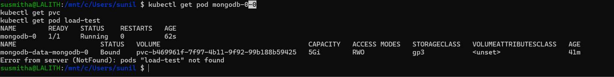

The orders are still there, still **Ready**:

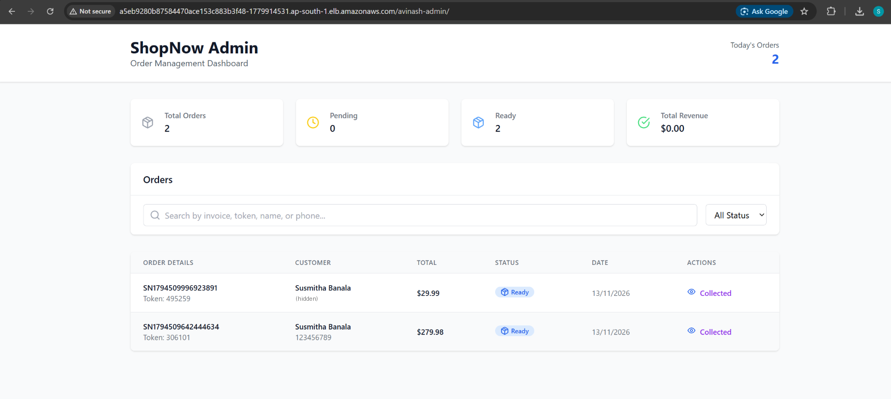

---

## Step 13 · Tear down the same night (~20 min)

**1. Remove what was added by hand** (laptop):

```bash
kubectl delete ingress shopnow-admin-api-ingress
helm uninstall monitoring -n monitoring
kubectl delete namespace monitoring
```

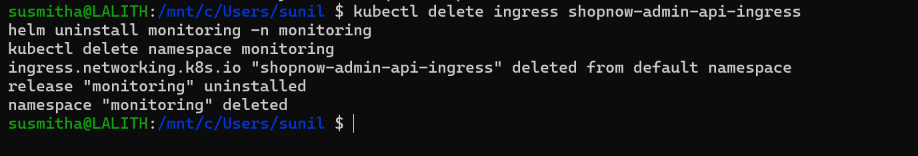

**2. Destroy the cluster through Jenkins.** Run **1-infra-terraform** with
`ACTION = destroy`. It deletes the load balancer and disks Kubernetes created,
asks for the cluster name to be typed as confirmation, then destroys all
**61** resources.

| Destroy parameters | Destroy finished |
|---|---|
| 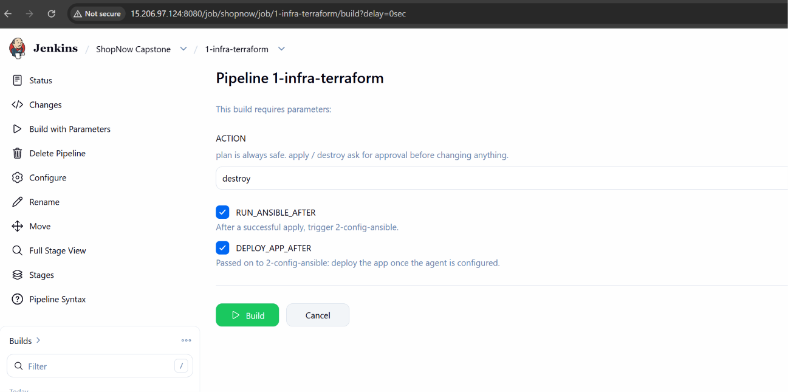 | 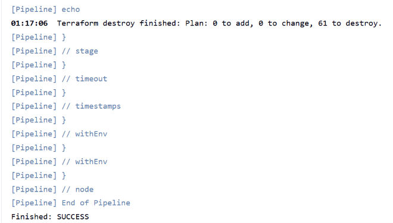 |

**3. Destroy the Jenkins server from the laptop** (Jenkins cannot delete itself):

```bash
cd terraform-Sushmita/jenkins
terraform destroy
```

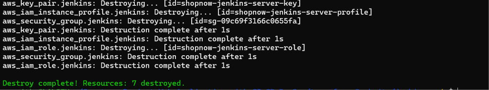

**4. Zero-cost check.** Every line must be empty:

```bash
aws eks list-clusters --region ap-south-1
aws ec2 describe-nat-gateways --region ap-south-1 --filter Name=state,Values=available,pending --query 'NatGateways[].NatGatewayId'
aws ec2 describe-instances --region ap-south-1 --filters Name=instance-state-name,Values=running,stopped,pending --query 'Reservations[].Instances[].InstanceId'
aws ec2 describe-addresses --region ap-south-1 --query 'Addresses[].PublicIp'
aws ec2 describe-volumes --region ap-south-1 --query 'Volumes[].VolumeId'
aws elb describe-load-balancers --region ap-south-1 --query 'LoadBalancerDescriptions[].LoadBalancerName'
aws elbv2 describe-load-balancers --region ap-south-1 --query 'LoadBalancers[].LoadBalancerName'
```

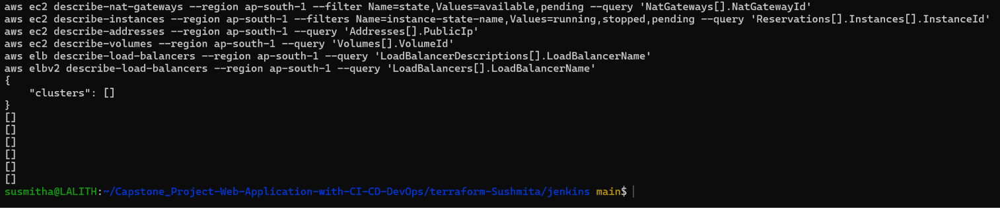

---

## Cost

| | |
|---|---|
| Everything running (EKS, 2 nodes, Jenkins, CI agent, NAT, load balancer) | about **$0.55–0.60 per hour** |
| This session: Jenkins up ~2.5 h, cluster up ~1.5 h | about **$1** (estimate) |
| Between sessions | about **$0**: only the S3 state bucket remains |

How we keep it low: build and destroy in the same session, then a zero-cost
check; one shared NAT gateway; EKS 1.36 on standard support ($0.10/hour, not
$0.60 on extended support); ECR keeps only the last 10 images; a $50 AWS budget
alert. Details: [`terraform-Sushmita/docs/cost-optimization.md`](../terraform-Sushmita/docs/cost-optimization.md).

---

## Who built what

| Person | Area | Folder | Shown in steps |
|---|---|---|---|
| Susmitha | Terraform / AWS: VPC, EKS, ECR, IAM, Jenkins server, CI agent, remote state, cost | [`terraform-Sushmita/`](../terraform-Sushmita/) | 1, 5, 6, 13 |
| Kaushik | Jenkins: installer, Configuration as Code, the three chained pipelines, tests | [`jenkins-Kaushik/`](../jenkins-Kaushik/), [`docs-Kaushik/`](../docs-Kaushik/), [`Jenkinsfile`](../Jenkinsfile) | 2–8, 13 |
| Avinash | Docker and Kubernetes: images, Deployments, Services, MongoDB, Ingress, HPA | [`docker-Avinash/`](../docker-Avinash/), [`kubernetes-Avinash/`](../kubernetes-Avinash/) | 8, 9, 11, 12 |
| Ravi | Ansible and monitoring: playbook, dynamic inventory, Prometheus, Grafana, alerts | [`ansible-Ravi/`](../ansible-Ravi/), [`monitoring-Ravi/`](../monitoring-Ravi/) | 7, 10 |

---

## Screenshot index

| # | Screenshot | Shows |
|---|---|---|
| 01 | [`01-jenkins-terraform-apply.png`](screenshots/01-jenkins-terraform-apply.png) | jenkins/ stack apply: 7 added; jenkins_url http://15.206.97.124:8080 |
| 02 | [`02-jenkins-ssh-login.png`](screenshots/02-jenkins-ssh-login.png) | SSH into Jenkins server (Amazon Linux 2023) with the shared key |
| 03 | [`03-clone-kaushik-branch.png`](screenshots/03-clone-kaushik-branch.png) | Project cloned on the Jenkins server, branch kaushik-live-validation @ efb8eb3 (supporting) |
| 04 | [`04-jenkins-install.png`](screenshots/04-jenkins-install.png) | install-jenkins.sh done: admin login OK; Java 21, Docker 25, Terraform 1.17.2, kubectl 1.36.6, Helm 3.22.1, Ansible core 2.19.15, AWS CLI 2.38 |
| 05 | [`05-jenkins-dashboard.png`](screenshots/05-jenkins-dashboard.png) | Logged in to Jenkins at 15.206.97.124:8080; ShopNow Capstone folder created by Configuration as Code (no setup wizard) |
| 06 | [`06-jenkins-jobs.png`](screenshots/06-jenkins-jobs.png) | ShopNow Capstone folder with the 3 jobs (1-infra-terraform, 2-config-ansible, 3-app-cicd), none run yet |
| 07 | [`07-jenkins-plugins.png`](screenshots/07-jenkins-plugins.png) | Manage Jenkins → Installed plugins: AWS Credentials, Ansible plugin, AWS SDK (installed from plugins.txt) |
| 08 | [`08-jenkins-credential.png`](screenshots/08-jenkins-credential.png) | Jenkins credential ci-agent-ssh (user ec2-user) — the only secret Jenkins holds; key never in git |
| 09 | [`09-infra-plan-build1-success.png`](screenshots/09-infra-plan-build1-success.png) | 1-infra-terraform build #1 (ACTION=plan) green, 55 s |
| 10 | [`10-jenkins-iam-role.png`](screenshots/10-jenkins-iam-role.png) | Preflight: Running as arn:aws:sts::095355901688:assumed-role/shopnow-jenkins-server-role/i-058225e332760eaa4; account check passes |
| 11 | [`11-infra-plan-summary.png`](screenshots/11-infra-plan-summary.png) | Build #1 PLAN SUMMARY: Plan: 61 to add, 0 to change, 0 to destroy; Approval skipped for plan |
| 12 | [`12-infra-plan-stage-view.png`](screenshots/12-infra-plan-stage-view.png) | 1-infra-terraform stage view for build #1 (plan): Checkout → Preflight → Init → Validate → Plan green; Approval/Apply skipped; tfplan.txt archived |
| 13 | [`13-infra-apply-parameters.png`](screenshots/13-infra-apply-parameters.png) | Build with Parameters: ACTION=apply, RUN_ANSIBLE_AFTER and DEPLOY_APP_AFTER ticked (one click runs Terraform → Ansible → app) |
| 14 | [`14-infra-approval.png`](screenshots/14-infra-approval.png) | Build #2 pauses at Approval: 'Apply this plan? Plan: 61 to add, 0 to change, 0 to destroy' with Apply / Abort (30 min timeout) |
| 15 | [`15-infra-apply-complete.png`](screenshots/15-infra-apply-complete.png) | Jenkins build #2: Apply complete! 61 added, 0 changed, 0 destroyed; CI agent IP and ingress paths in the outputs |
| 16 | [`16-ansible-success-triggers-app.png`](screenshots/16-ansible-success-triggers-app.png) | 2-config-ansible: Finished SUCCESS, then starts 3-app-cicd (Ansible → app chain) |
| 17 | [`17-ansible-run1-recap.png`](screenshots/17-ansible-run1-recap.png) | Ansible first run PLAY RECAP on the CI agent: ok=13 changed=4 unreachable=0 failed=0 |
| 18 | [`18-ansible-idempotent.png`](screenshots/18-ansible-idempotent.png) | Second Ansible run PLAY RECAP ok=13 changed=0 failed=0 → 'Second run: changed=0 - playbook is idempotent'; then schedules 3-app-cicd |
| 19 | [`19-app-pipeline-stage-view.png`](screenshots/19-app-pipeline-stage-view.png) | 3-app-cicd #1 (app@c262764 → tag 1) stage view all green: Checkout, Preflight, Static checks & unit tests, Backend, Dockerfile lint, Manifest check, Build images 1m51s, Container tests, Push to ECR, Deploy to EKS, Smoke tests (~4 min); archived manifests + smoke-test.log |
| 20 | [`20-smoke-tests.png`](screenshots/20-smoke-tests.png) | smoke-test.log: in-cluster PASS (backend /api/health, /api/products DB, frontend, admin) + external PASS through LB (GET /avinash/, /avinash-admin/, /avinash/api/health); APP_URL / ADMIN_URL; "All smoke tests passed" |
| 21 | [`21-app-frontend-avinash.png`](screenshots/21-app-frontend-avinash.png) | Storefront live at <LB>/avinash/ (built by Jenkins with USER_NAME=avinash); 6 products loaded from MongoDB |
| 22 | [`22-order-placed-token.png`](screenshots/22-order-placed-token.png) | Checkout on /avinash: 'Order placed successfully! Your token is: 306101', invoice downloaded; cash on delivery (email masked) |
| 23 | [`23-kubectl-nodes.png`](screenshots/23-kubectl-nodes.png) | Laptop kubectl to the Jenkins-built cluster: 2 nodes Ready, v1.36.5-eks, age 32m |
| 24 | [`24-app-admin-real-orders.png`](screenshots/24-app-admin-real-orders.png) | Admin at <LB>/avinash-admin/ shows the real orders from MongoDB: tokens 306101 ($279.98) and 495259 ($29.99), Total 2, Pending 2 (one phone masked) |
| 25 | [`25-app-admin-orders-ready.png`](screenshots/25-app-admin-orders-ready.png) | Both orders marked Ready (Pending 0, Ready 2); next action Collected — full order flow works end to end (one phone masked) |
| 26 | [`26-monitoring-helm-deployed.png`](screenshots/26-monitoring-helm-deployed.png) | Ravi's monitoring: helm install kube-prometheus-stack 92.14.1 with monitoring-Ravi/values.yaml → STATUS: deployed (namespace monitoring) |
| 27 | [`27-monitoring-pods-alert-rules.png`](screenshots/27-monitoring-pods-alert-rules.png) | PrometheusRule shopnow-ravi-alerts created (4 alerts); 7 monitoring pods Running: Alertmanager, Grafana, operator, kube-state-metrics, 2 node-exporters, Prometheus |
| 28 | [`28-grafana-login.png`](screenshots/28-grafana-login.png) | Grafana reached through kubectl port-forward (ClusterIP only, not public) at localhost:3000 (supporting) |
| 29 | [`29-grafana-shopnow-dashboard-listed.png`](screenshots/29-grafana-shopnow-dashboard-listed.png) | Ravi's 'ShopNow Application Health' dashboard listed in Grafana (tags application, capstone, shopnow) |
| 30 | [`30-grafana-shopnow-dashboard.png`](screenshots/30-grafana-shopnow-dashboard.png) | Ravi's ShopNow Application Health dashboard, live: 6 available replicas, 0 restarts (15m), CPU and memory by pod, 2 replicas per deployment |
| 31 | [`31-grafana-cluster-resources.png`](screenshots/31-grafana-cluster-resources.png) | Grafana 'Kubernetes / Compute Resources / Cluster': CPU 4.05%, CPU requests 59.1%, memory 19.6%; per-namespace pods/CPU (kube-system, default, monitoring, ingress-nginx) |
| 32 | [`32-grafana-node-exporter.png`](screenshots/32-grafana-node-exporter.png) | Grafana 'Node Exporter / Nodes' for node 10.0.43.250: CPU, load (2 logical cores), memory 21.3%, disk 6.71 of 21.4 GB used |
| 33 | [`33-prometheus-jenkins-target-up.png`](screenshots/33-prometheus-jenkins-target-up.png) | Prometheus target health: job jenkins, http://15.206.97.124:8080/prometheus, 1/1 UP (scraped through the NAT IP → Jenkins 8080 rule from Terraform) |
| 34 | [`34-prometheus-port-forward.png`](screenshots/34-prometheus-port-forward.png) | kubectl port-forward to Prometheus (ClusterIP only, not public) (supporting) |
| 35 | [`35-prometheus-shopnow-alert-rules.png`](screenshots/35-prometheus-shopnow-alert-rules.png) | Prometheus alerts: Ravi's group shopnow.cluster.rules loaded (INACTIVE (4) = healthy); ShopNowDeploymentReplicasUnavailable expanded: expression, for 5m, severity warning |
| 36 | [`36-hpa-scale-up.png`](screenshots/36-hpa-scale-up.png) | HPA under load (busybox load-test, 16 loops on /api/products): CPU 0% → 84% → 186% → 240% of target 70%; backend replicas 2 → 3 → 4 (max) |
| 37 | [`37-hpa-backend-pods-4.png`](screenshots/37-hpa-backend-pods-4.png) | 4 backend pods Running: 2 original (39m) + 2 added by the HPA (75s, 60s) |
| 38 | [`38-mongodb-pod-recreated.png`](screenshots/38-mongodb-pod-recreated.png) | Self-healing: mongodb-0 deleted on purpose → StatefulSet recreates it (ContainerCreating → Running 1/1 in ~6 s); load-test pod removed |
| 39 | [`39-mongodb-pvc-same-disk.png`](screenshots/39-mongodb-pvc-same-disk.png) | New mongodb-0 Running (62 s old) while PVC mongodb-data-mongodb-0 is still Bound to the same 5Gi gp3 volume (41 m old); load-test gone |
| 40 | [`40-mongodb-data-persisted.png`](screenshots/40-mongodb-data-persisted.png) | After the MongoDB pod restart both orders (306101, 495259) are still there and still Ready — data persisted on the gp3 volume (one phone masked) |
| 41 | [`41-grafana-hpa-scaling.png`](screenshots/41-grafana-hpa-scaling.png) | Grafana ShopNow dashboard during/after the load test: available replicas 6 → 8; backend-deployment line 2 → 3 → 4; CPU spike to ~0.2 cores per backend pod then back to 0; 0 restarts |
| 42 | [`42-teardown-monitoring-removed.png`](screenshots/42-teardown-monitoring-removed.png) | Teardown 1/4: monitoring uninstalled, monitoring namespace and the admin API route removed |
| 43 | [`43-infra-destroy-parameters.png`](screenshots/43-infra-destroy-parameters.png) | 1-infra-terraform Build with Parameters: ACTION=destroy (typed cluster-name confirmation required) |
| 44 | [`44-infra-destroy-complete.png`](screenshots/44-infra-destroy-complete.png) | Jenkins build #3: "Terraform destroy finished: Plan: 0 to add, 0 to change, 61 to destroy" — Finished: SUCCESS |
| 45 | [`45-jenkins-destroy-complete.png`](screenshots/45-jenkins-destroy-complete.png) | Laptop terraform destroy in jenkins/: Destroy complete! 7 destroyed (Jenkins EC2, EIP, SG, key pair, IAM role/profile) |
| 46 | [`46-zero-check.png`](screenshots/46-zero-check.png) | Zero-cost check after teardown: no EKS cluster, NAT gateway, EC2 instance, Elastic IP, EBS volume, Classic or ALB/NLB load balancer |
