# Screenshots: Terraform / AWS (Susmitha)

Live run on **12 November 2026**, AWS Mumbai (`ap-south-1`). Everything was
built with Terraform from `main`, the app was deployed and used, and everything
was destroyed the same evening.

Summary of my work: [`terraform-Sushmita/WORK-SUMMARY.md`](../../terraform-Sushmita/WORK-SUMMARY.md)

## 1. Terraform

**01 · Jenkins server stack**: `terraform apply` in `terraform-Sushmita/jenkins/`.
7 added, 0 changed, 0 destroyed. IAM role, key pair, security group, EC2, Elastic IP.

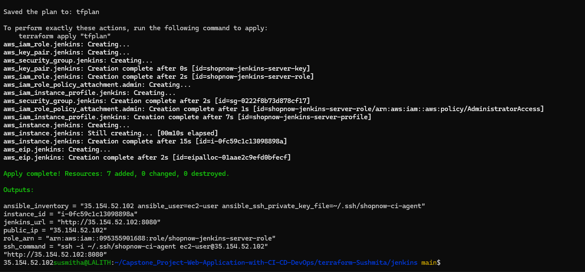

**02 · Cluster stack plan**: `terraform plan` in `envs/dev`. 50 to add, 0 to destroy.

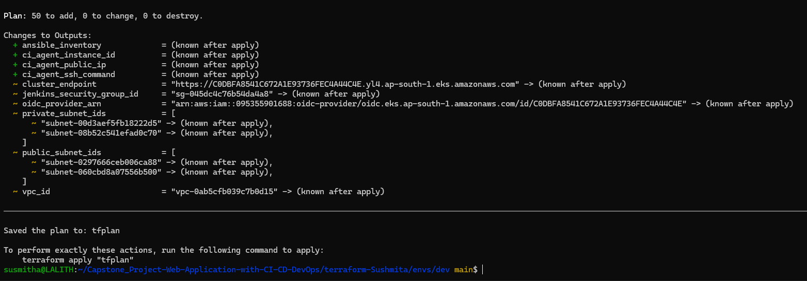

**03 · Cluster stack apply**: 50 added. The outputs are what the team uses:
ingress paths, CI agent address, ECR URLs, `--build-arg USER_NAME=avinash`.

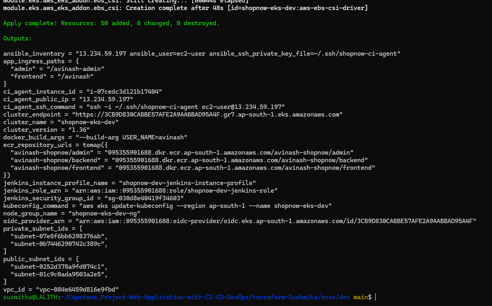

## 2. The cluster

**04 · Nodes, add-ons, storage**: 2 nodes Ready on Kubernetes 1.36; the 5 add-ons
Terraform installs; `gp3` set as the default StorageClass.

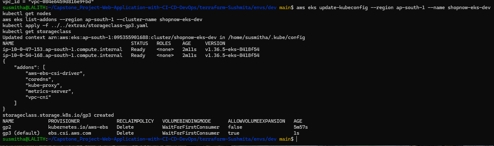

**05 · `kubectl top nodes`**: metrics-server works, which the HPA needs.

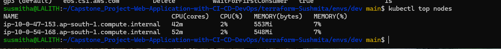

## 3. The app on EKS

**06 · ECR**: the image tag in the frontend repo.

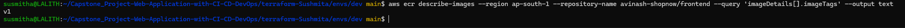

**07 · Kubernetes resources**: 7 pods Running (2 each for frontend, admin and
backend, plus `mongodb-0`); MongoDB's 5 GiB gp3 volume `Bound`; the backend HPA
(2–4 pods, 70% CPU); 3 Ingresses behind one load balancer.

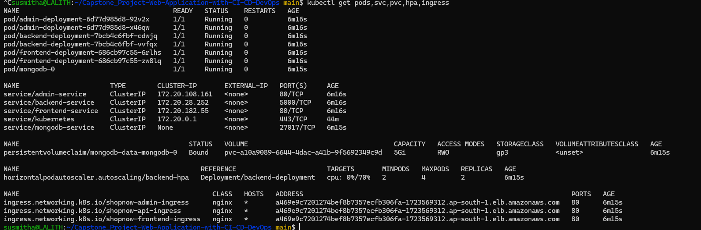

## 4. The shop in a browser

**08 · Storefront**: products loaded from MongoDB through the API.

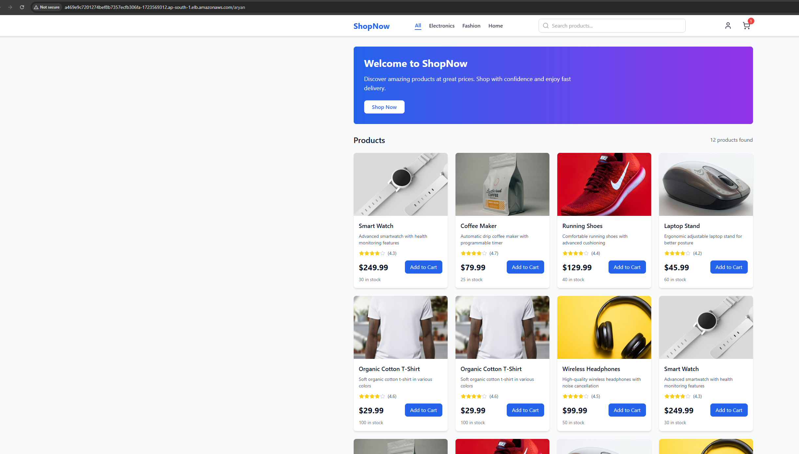

**09 · Admin panel**: the order just placed: invoice `SN1794492586411187`,
pickup token `322428`, $249.99, Pending. (Phone number hidden.)

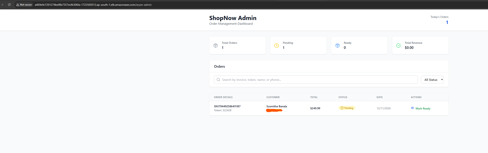

> **Why `/aryan` in the address bar?** The images in ECR at the time were built
> with the app's default `USER_NAME=aryan`, and that path is baked in at build
> time. For this trial I added a temporary route for `/aryan`, removed at
> teardown. Kaushik's Jenkins run the same day rebuilt the images with
> `USER_NAME=avinash`, and `/avinash` and `/avinash-admin` returned HTTP 200.

## 5. Teardown

**10 · Zero-cost check after my trial run**: no EKS cluster, NAT gateway, EC2
instance, Elastic IP, EBS volume or load balancer (Classic or ALB/NLB) left.

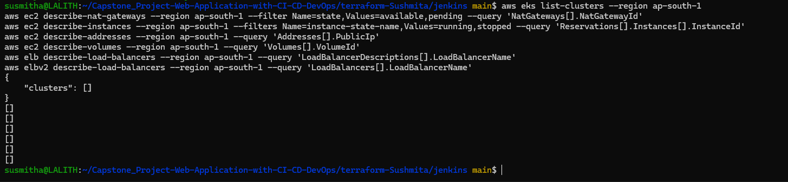

**11 · Independent check after Kaushik's pipeline run**: same checks all empty,
and both Terraform states empty. The ECR repos were removed too, because that run
used a full destroy; the next `terraform apply` recreates them.

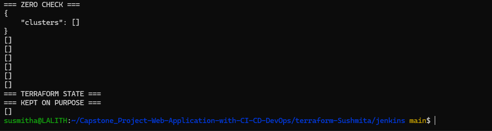
